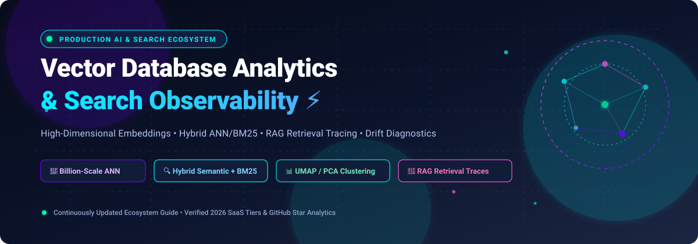

# 🎯 Awesome Vector Database Analytics & Search Observability ⚡

    

## 🌟 Top Vector Database Analytics & Search Observability Ecosystem 🔭

**A Curated Directory of Enterprise SaaS Solutions & Open-Source Projects for AI Engineers, Search Architects, and Data Platform Leaders** 🚀  

*Focused on Billion-Scale Approximate Nearest Neighbor (ANN) Indexing, Hybrid Semantic/BM25 Search, High-Dimensional Embedding Visualizers, RAG Retrieval Observability, and Real-Time Vector Query Performance Telemetry.* 🧠📊

**Last updated: November 2026** 📅

---

### 🔍 Quick Navigation & Table of Contents 📑

- [📊 Sector Overview & Market Dynamics](#-sector-overview--market-dynamics)
- [☁️ SaaS & Hosted Platforms](#️-saashosted-platforms)
- [💻 Open-Source GitHub Projects](#-open-source-github-projects)
- [📈 Star History](#-star-history)
- [🤝 Support & Sponsorship](#-support--sponsorship)
- [🛠️ How to Contribute](#️-how-to-contribute)
- [📜 Disclaimer](#-disclaimer)

---

## 📊 Sector Overview & Market Dynamics

The global Vector Database and Neural Search Observability market is valued at approximately **$2.1 Billion to $3.4 Billion in 2024–2026**, projected to surge past **$14.8 Billion to $18.5 Billion by 2032** at an accelerating compound annual growth rate (CAGR) of **~28.5% to 31.2%**, propelled by enterprise Retrieval-Augmented Generation (RAG), multimodal AI embeddings, and autonomous agent memory architectures. 📈🚀

Market structure reflects a **bifurcated, moderately concentrated landscape**: enterprise-grade transactional vector layers are led by established search giants (Elastic, DataStax Cassandra) and well-funded specialized pure-plays (Pinecone, Qdrant, Weaviate, Zilliz/Milvus), while the observability, retrieval tracing, and embedding evaluation tier remains **vibrantly fragmented** across dedicated evaluation frameworks (Arize Phoenix, Langfuse, Ragas, TruLens) where no single vendor holds a monopoly. 🌐🔍

---

## ☁️ SaaS/Hosted Platforms

Production-ready managed vector databases, hybrid neural search engines, and RAG retrieval observability platforms. **Sorted by Company Size / Valuation / Revenue (Descending)**: 🏆

| Platform / Product | Organization / Company | Company Size / Valuation / Revenue | Starting Paid Tier Pricing | Free Tier Limits / Trial Limits | Core Focus & Search Capabilities |
| :--- | :--- | :--- | :--- | :--- | :--- |
| **[Elastic Cloud](https://elastic.co)** 🔍 | Elastic N.V. (NYSE: ESTC) | **$10.2B+ Market Cap** (~$1.4B+ Annual Revenue) | **$95/month** (Standard Cloud tier; usage-based hourly compute & storage increments) | **14-day free trial** with full access to Elasticsearch Serverless, Kibana, and Elastic APM vector search telemetry (no credit card required) | Enterprise search & observability combining dense/sparse vector search (HNSW/BBQ), BM25 keyword retrieval, and Kibana analytics. |
| **[DataStax Astra DB](https://datastax.com)** ⚡ | DataStax, Inc. | **$1.6B+ Valuation** (~$150M+ ARR; backed by Goldman Sachs, Alphabet GV) | **$0.25 per million read units**, **$1.25 per million write units**, and **$0.30/GB-month storage** (Serverless pay-as-you-go) | **$25/month perpetual free credit** (~5M operations and ~30GB storage per month forever without auto-charge) | Serverless cloud database built on Apache Cassandra featuring JVector-powered low-latency vector search and hybrid retrieval. |
| **[Pinecone](https://pinecone.io)** 🌲 | Pinecone Systems, Inc. | **$750M Valuation** (Series B; $138M funding led by Andreessen Horowitz) | **$0.33/hour per dedicated pod** (Pod-based) or **$0.08 per 1M read units + $2.00 per 1M write units + $0.33/GB-month** (Standard Serverless) | **Free forever plan** with 1 index, up to 100,000 vectors (or 2GB of serverless storage), and 2M read units/month included | Managed serverless vector database offering real-time indexing, sparse-dense hybrid search, metadata filtering, and namespace isolation. |
| **[Zilliz Cloud](https://zilliz.com)** 🦅 | Zilliz, Inc. (Creators of Milvus) | **$600M+ Valuation** (Series B; $113M funding led by Prosperity7, Temasek) | **$0.08/CU/hour** (Standard Serverless; ~**$58/month** for a minimal provisioned cluster) | **$100 in free credits** valid for 30 days upon sign-up, plus a **Free Tier** supporting 2 collections and up to 1M vectors | Enterprise cloud vector database built on open-source Milvus featuring DiskANN/HNSW GPU indexing, auto-scaling, and query telemetry. |
| **[Weaviate Cloud (WCD)](https://weaviate.io)** 🌀 | Weaviate B.V. | **$200M+ Valuation** (Series B; $67M funding led by Index Ventures, Battery) | **$0.085 per 1M vector dimensions stored / month** (~**$25/month** minimum Standard tier sandbox) | **14-day free trial cluster** (no credit card required; up to 500k vectors with complete hybrid BM25 + vector search capabilities) | AI-native vector database providing modular embedding pipelines, hybrid vector/BM25 search, generative RAG modules, and multi-tenancy. |
| **[Arize AX & Phoenix Cloud](https://arize.com)** 🔭 | Arize AI, Inc. | **$150M+ Valuation** (Series B; $61M funding led by Foundation Capital, TCV) | **$50/month** (Starter tier for up to 5 team members and 100k traced spans/month) | **Free forever plan** offering up to 2 team members, 20,000 traced evaluation spans/month, and 3D UMAP embedding visualizations | AI observability & LLM/RAG evaluation platform offering 3D UMAP embedding drift visualization and search trace analytics. |
| **[Qdrant Cloud](https://qdrant.io)** 🦀 | Qdrant Solutions GmbH | **$120M+ Valuation** (Series A; $37.8M funding led by Spark Capital) | **$25/month** (Standard Cloud tier for dedicated 1GB RAM / 0.5 vCPU cluster node) | **Free forever tier** with 1 cluster (1GB RAM, ~4GB disk, up to ~100k vectors, permanent without credit card) | Managed vector search engine built on Rust-powered Qdrant featuring multitenancy, scalar/binary quantization, and telemetry. |
| **[Chroma Cloud](https://trychroma.com)** 🌈 | Chroma (Jeff Huber, Anton Troynikov) | **$75M+ Valuation** (Seed; $20.3M funding led by Quiet Capital, AIX) | **$0.10 per 1M read operations** and **$1.50 per 1M writes** (Serverless pay-as-you-go starting tier) | **Free Developer tier** with up to 1,000,000 hosted embeddings, 5 collections, and community support | Managed serverless hosting for open-source Chroma with fast collection management and developer-friendly search APIs. |
| **[Vespa Cloud](https://vespa.ai)** ⚡ | Vespa.ai (Yahoo Spin-out) | **$60M+ Valuation** (Backed by Blossom Capital) | **$0.024 per vCPU hour** + **$0.003 per GB RAM hour** (~**$40/month** entry-level enclave) | **$150 free usage credits** granted for the first 30 days to deploy and benchmark custom application clusters | Big-data serving engine uniting vector search, lexical search, tensor ranking, and real-time ML inference at massive scale. |
| **[Marqo Cloud](https://marqo.ai)** 🎨 | Marqo Technologies Pty Ltd | **$45M+ Valuation** (Series A; $17.8M funding led by Lightspeed Venture Partners) | **$0.19/hour** (~**$137/month** for a minimal dedicated multimodal index node) | **$100 free credit coupon** on sign-up valid for 30 days of testing and hybrid search evaluation | Multimodal vector search platform handling embedding inference, image-text indexing, and relevance ranking via a single API. |
| **[Activeloop Deep Lake](https://activeloop.ai)** 🌊 | Activeloop, Inc. | **$40M+ Valuation** (Series A; $16M funding led by Streamlined, Y Combinator) | **$39/month** (Team Starter tier with automated data versioning and multi-user access) | **Free forever tier** with up to 5GB storage, 50,000 vector embeddings, and local/remote PyTorch streaming dataloaders | Multi-modal AI database engineered for storing embeddings, audio, and tensors with version control and streaming RAG queries. |

---

## 💻 Open-Source GitHub Projects

Curated list of production-ready vector databases, approximate nearest neighbor (ANN) indexing libraries, embedding cluster explorers, and RAG retrieval observability frameworks. **Sorted by GitHub Stargazers (Descending)**: 🌟

- **[Elasticsearch (elastic/elasticsearch)](https://github.com/elastic/elasticsearch)**  🔍  
  Open-source/AGPL distributed search and analytics engine offering dense vector HNSW search, ELSER sparse semantic retrieval, and Kibana search telemetry.

- **[Hindsight by Vectorize (vectorize-io/hindsight)](https://github.com/vectorize-io/hindsight)**  🧠  
  Open-source agentic memory and retrieval engine designed to give AI agents structured long-term recall, temporal/entity/semantic search, and inspectable memory traces.

- **[Meilisearch (meilisearch/meilisearch)](https://github.com/meilisearch/meilisearch)**  ⚡  
  Lightning-fast open-source search engine written in Rust offering typo-tolerant full-text search alongside hybrid semantic vector search and a built-in search preview UI.

- **[Milvus (milvus-io/milvus)](https://github.com/milvus-io/milvus)**  🦅  
  CNCF graduated open-source cloud-native vector database engineered for billion-scale similarity search with GPU-accelerated CAGRA/IVF indexing, hybrid search, and Prometheus/Grafana observability.

- **[Faiss (facebookresearch/faiss)](https://github.com/facebookresearch/faiss)**  🚀  
  Library for efficient similarity search and clustering of dense vectors developed by Meta Fundamental AI Research, supporting GPU-acceleration and inverted file quantization.

- **[Langfuse (langfuse/langfuse)](https://github.com/langfuse/langfuse)**  🪢  
  Open-source LLM engineering and observability platform providing detailed trace inspection, retrieval latency/cost analytics, and relevance evaluation datasets for vector search pipelines.

- **[Qdrant (qdrant/qdrant)](https://github.com/qdrant/qdrant)**  🦀  
  High-performance open-source vector similarity search engine and database written in Rust featuring rich payload filtering, scalar/product/binary quantization, and a built-in Web UI dashboard.

- **[Chroma (chroma-core/chroma)](https://github.com/chroma-core/chroma)**  🌈  
  Developer-friendly open-source AI-native embedding database written in Rust and Python for rapid local prototyping and self-hosted RAG applications.

- **[Typesense (typesense/typesense)](https://github.com/typesense/typesense)**  💡  
  Fast, open-source in-memory search engine written in C++ supporting instant keyword search, conversational RAG, and built-in vector similarity search.

- **[pgvector (pgvector/pgvector)](https://github.com/pgvector/pgvector)**  🐘  
  Open-source vector similarity search extension for PostgreSQL bringing HNSW and IVFFlat indexing, half-precision/binary vectors, and ACID transactional integrity directly into Postgres.

- **[Weaviate (weaviate/weaviate)](https://github.com/weaviate/weaviate)**  🌀  
  Open-source AI-native vector database written in Go supporting hybrid BM25F + vector search, dynamic HNSW/Flat/PQ indexing, GraphQL/gRPC APIs, and multi-tenancy.

- **[Ragas (explodinggradients/ragas)](https://github.com/explodinggradients/ragas)**  📏  
  Open-source evaluation framework quantifying vector search and RAG pipeline performance using Context Precision, Context Recall, Faithfulness, and synthetic testset generation.

- **[Annoy (spotify/annoy)](https://github.com/spotify/annoy)**  🎵  
  C++ library with Python bindings by Spotify to search for points in space that are close to a given query point, using random projection trees.

- **[OpenSearch (opensearch-project/OpenSearch)](https://github.com/opensearch-project/OpenSearch)**  🔎  
  Apache 2.0 open-source distributed search and analytics suite featuring k-NN vector search (Faiss, Lucene, NMSLIB), hybrid neural-lexical pipelines, and OpenSearch Dashboards observability.

- **[Arize Phoenix (Arize-ai/phoenix)](https://github.com/Arize-ai/phoenix)**  🔭  
  Leading open-source AI observability and evaluation platform featuring interactive 3D UMAP embedding visualizations, OpenTelemetry RAG retrieval tracing, and chunk relevance scoring.

- **[LanceDB (lancedb/lancedb)](https://github.com/lancedb/lancedb)**  🛡️  
  Developer-friendly, serverless open-source vector database built in Rust on the columnar Lance format for zero-copy multimodal data storage, full-text search, and embedded/cloud deployment.

- **[Vespa Engine (vespa-engine/vespa)](https://github.com/vespa-engine/vespa)**  ⚙️  
  Open-source big data processing and serving engine supporting real-time HNSW vector search, lexical ranking, ColBERT multi-vector scoring, and custom ML ranking expressions.

- **[ANN-Benchmarks (erikbern/ann-benchmarks)](https://github.com/erikbern/ann-benchmarks)**  🏁  
  Standard industry benchmarking suite for evaluating and comparing recall, latency, index size, and build times across approximate nearest neighbors search algorithms.

- **[HNSWLib (nmslib/hnswlib)](https://github.com/nmslib/hnswlib)**  🕸️  
  Fast header-only C++ library with Python bindings for approximate nearest neighbor search based on Hierarchical Navigable Small World graphs.

- **[Embedding Atlas (apple/embedding-atlas)](https://github.com/apple/embedding-atlas)**  🗺️  
  Open-source interactive visualization tool from Apple for exploring, clustering, and searching massive high-dimensional embedding datasets directly in the browser.

- **[Marqo OSS (marqo-ai/marqo)](https://github.com/marqo-ai/marqo)**  🎯  
  Open-source tensor search engine integrating PyTorch/ONNX embedding inference directly inside the vector database for multimodal text and image search.

- **[USearch (unum-cloud/usearch)](https://github.com/unum-cloud/usearch)**  ⚡  
  Fast, compact, and SIMD-optimized vector search engine and single-file library supporting HNSW graphs and native float16/int8/bit quantization.

- **[TruLens (truera/trulens)](https://github.com/truera/trulens)**  📐  
  Open-source evaluation and tracking library measuring the RAG Triad (Context Relevance, Groundedness, Answer Relevance) to diagnose vector database retrieval quality.

- **[pgvectorscale (timescale/pgvectorscale)](https://github.com/timescale/pgvectorscale)**  📈  
  Open-source Rust extension by Timescale complementing `pgvector` with StreamingDiskANN indexing and Statistical Binary Quantization (SBQ) for high-recall Postgres vector workloads.

- **[Vald (vdaas/vald)](https://github.com/vdaas/vald)**  🚢  
  CNCF open-source highly scalable distributed fast approximate nearest neighbor (ANN) dense vector search engine built on the NGT algorithm for Kubernetes.

- **[Spotlight by Renumics (Renumics/spotlight)](https://github.com/Renumics/spotlight)**  🔦  
  Interactive open-source visual data curation and embedding analytics tool combining similarity maps, UMAP projections, and multimodal data inspection in the browser.

- **[WizMap (poloclub/wizmap)](https://github.com/poloclub/wizmap)**  🗺️  
  Scalable open-source web-based visual explorer capable of smoothly rendering and summarizing millions of vector embeddings with multi-resolution contour maps.

---

## 📈 Star History

---

## 🤝 Support & Sponsorship

Thank you so much for exploring and using this curated directory! If you find this vector database analytics and search observability ecosystem guide helpful:

- ⭐ **Star this repository** to help others discover it and support ongoing maintenance.
- 🍴 **Fork the repository** to contribute updates, benchmarks, and new production tools.
- 📢 **Share with your team** and AI/data engineering community across Discord, X/Twitter, and LinkedIn.
- ☕ **Support the maintainer**: Consider buying a coffee or sponsoring continued open-source research via the **[GitHub Sponsors Dashboard](https://github.com/sponsors/ishandutta2007)**. Your support directly funds verified benchmarking and regular updates!

---

## 🛠️ How to Contribute

Contributions are warmly welcome! To submit a new SaaS platform, open-source vector tool, embedding explorer, or observability framework:

1. Fork this repository.
2. Add your entry following the established format:
   - For SaaS tools: Include verified company size / valuation / ARR, starting paid tier pricing, and explicit free tier or trial limits.
   - For Open-Source projects: Include repository handle, social Stars_Badge linked to stargazers, and a factual technical description.
3. Submit a pull request with a descriptive title and reference links.

---

## 📜 Disclaimer

*This repository is curated for informational, educational, and benchmarking purposes only. Trademarks, logos, and product names are property of their respective owners. Pricing tiers, free limits, valuation figures, and Stars_Counts are verified against public documentation as of late 2024–2026 and are subject to change by respective vendors.*
